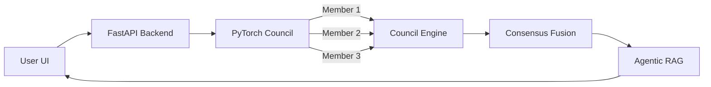

<div align="center">

# CouncilMed

**Multi-Model, Agent-Assisted Medical Imaging Analysis Workstation**

*Evidence-based clinical consensus through an ensemble of independent AI council members.*

</div>

---

## 1. Project Identity

CouncilMed is a local-first medical imaging workstation that applies an ensemble "council" of AI models to analyze medical scans. Rather than relying on a single neural network, CouncilMed fuses predictions from multiple independent models using entropy-weighted uncertainty, ensuring that AI-assisted medical insights are robust, traceable, and evidence-based.

## 2. Why This Exists

In medical imaging, single-model AI systems are prone to silent failures and out-of-distribution hallucinations. When a single model makes a confident error, it can mislead clinicians. 

CouncilMed exists to solve this "single-point-of-failure" problem. By forcing multiple distinct model architectures to evaluate the same study, the system can identify areas of disagreement and quantify uncertainty before presenting a finding to the human reviewer.

## 3. What Makes It Different

- **Uncertainty-Weighted Fusion**: It doesn't just average model outputs. The Council Engine uses Shannon entropy to weight each model's contribution based on its calculated confidence.
- **Agentic Explanation Layer**: If enabled, an integrated local LLM (Ollama) grounds the mathematical model outputs in actual clinical guidelines retrieved from a vector database (ChromaDB).
- **Traceable Evidence**: Every final insight explicitly links back to the specific "Council Member" (model) that generated the probability. Nothing is fabricated.

## 4. Key Features

- 🧠 **Dynamic Model Registry**: Easily plug-and-play new models via YAML manifests without altering core code.
- 🖼️ **Clinical Image Viewer**: Integrated workstation UI to examine scans alongside Grad-CAM explainability heatmaps.
- 🔒 **Local-First Architecture**: 100% of the processing (PyTorch + LLM + Vector DB) happens on the local machine. Zero PHI data leakage.
- 📊 **SQLite Audit Trail**: Every inference, model disagreement, and human review decision is recorded persistently.

## 5. Architecture



*(For a more detailed breakdown, see [`docs/ARCHITECTURE.md`](docs/ARCHITECTURE.md))*

## 6. How It Works

1. **Upload**: A medical image is dropped into the React UI with a selected Modality (e.g. Brain MRI, Chest X-Ray, CT Scan).
2. **Registry Lookup**: The backend loads all PyTorch `.pth` models registered for that specific modality.
3. **Inference**: The image is passed through the neural networks concurrently.
4. **Fusion**: The Council Engine evaluates the logits, calculates entropy, and produces a consensus.
5. **Agentic RAG**: (Optional) A local LLM retrieves context from ChromaDB and explains the consensus.
6. **Review**: The clinician reviews the models' evidence and the AI explanation on the workstation.

## 7. Technology Stack

- **Frontend**: React, TypeScript, Vite, Tailwind CSS, Framer Motion
- **Backend**: Python 3.10+, FastAPI, Uvicorn
- **AI/ML**: PyTorch (Inference), Torchvision
- **Agentic Logic**: Ollama (Local LLM), LangChain, ChromaDB (Vector RAG)
- **Database**: SQLite (Local Audit Trail)

## 8. Project Structure

```text
CouncilMed/
├── backend/               # Python FastAPI backend & AI pipelines
│   ├── agents/            # Ollama LLM integration
│   ├── api/               # REST Endpoints
│   ├── council/           # Entropy-fusion engine
│   ├── database/          # SQLite models
│   └── inference/         # PyTorch execution
├── docs/                  # Architectural documentation
├── model_registry/        # YAML manifests & PyTorch .pth weights
├── src/                   # React frontend application
└── package.json           # Node scripts and dependencies
```

## 9. Installation & Setup

### Prerequisites
- Node.js 18+
- Python 3.10+
- (Optional) CUDA-capable GPU for faster PyTorch inference
- (Optional) [Ollama](https://ollama.com/) running locally for Agentic features

### Setup Instructions

1. **Clone the repository:**
```bash
git clone https://github.com/iamnih4l/CouncilMed.git
cd CouncilMed
```

2. **Install Frontend Dependencies:**
```bash
npm install
```

3. **Install Backend Dependencies:**
```bash
python -m pip install -r backend/requirements.txt
```

4. **Initialize the System (Models & Database):**
```bash
python scripts/startup.py --check
```

5. **Start the Application:**
```bash
npm run dev
```
*This command uses `concurrently` to launch both the Vite frontend (port 5173) and the FastAPI backend (port 8000).*

## 10. Environment Variables

Currently, CouncilMed operates entirely locally without requiring API keys.
No `.env` file is required for default execution.

## 11. Usage

1. Open `http://localhost:5173` in your browser.
2. Select a modality from the dropdown (e.g., "Brain MRI", "Chest X-Ray", "CT Scan").
3. Drop a `.jpg` or `.png` medical scan into the dropzone.
4. Watch as the Council Members evaluate the image and generate a fused consensus.

## 12. API Documentation

The backend exposes a FastAPI REST API. Once running, visit `http://localhost:8000/docs` to view the interactive Swagger UI.

**Key Endpoint:**
`POST /api/analyze/upload`
- Accepts `multipart/form-data` with an image `file`.
- Query params: `modality` (e.g. MRI), `anatomy` (e.g. brain).

## 13. Demo

*The Workstation UI provides a complete clinical dashboard for evidence review.*

## 14. Technical Details

- **Dummy Weights Warning**: The current repository uses `scripts/generate_weights.py` to create structural PyTorch models with random initialization (`weights=None`). **To achieve clinical accuracy, these `.pth` files must be replaced with genuinely trained models.**
- **Entropy Weighting**: The fusion engine calculates $H(p) = - \sum p_i \log(p_i)$ to discount models that are unsure (high entropy) and boost models that are confident (low entropy).

## 15. Security & Privacy

This application is designed specifically for HIPAA-compliant environments by enforcing a strict **offline-first** architecture. No image data is transmitted to the cloud.

## 16. Testing

The repository uses standard ESLint and TypeScript compilation for the frontend.
```bash
npm run lint
npm run build
```

## 17. Deployment

CouncilMed is designed to be run as a local workstation application. While it can be deployed to a cloud server using Docker, doing so would require securing the FastAPI endpoints and configuring a production WGSI server (like Gunicorn) in place of Uvicorn.

## 18. Roadmap

- [ ] **DICOM Support**: Complete the `pydicom` integration pipeline.
- [ ] **Tauri Desktop**: Finalize the Rust/Tauri build for standalone desktop distribution without Node.js.
- [ ] **Real Weights**: Train and integrate actual PyTorch weights for the Brain MRI pipeline.

## 19. Contributing

Contributions are welcome, particularly in expanding the `model_registry` with new clinical architectures. Please ensure that any new models include a complete YAML manifest defining their modality, framework, and exact tensor shapes.

## 20. License

*Research License* - See repository for details.
