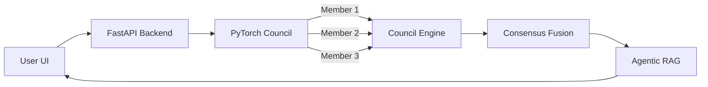

<div align="center">

# CouncilMed

**Multi-Model, Agent-Assisted Medical Imaging Analysis Workstation**

*Evidence-based clinical consensus through an ensemble of independent AI council members.*

[](https://council-med.vercel.app/)
[](https://huggingface.co/spaces/Mohammed12345678/CouncilAI)
[](https://council-med.vercel.app/)

</div>

---

## 🌟 Live Deployments

- 🏥 **Clinical Workstation UI**: [https://council-med.vercel.app/](https://council-med.vercel.app/)  
  *Executive HUD navigation bar, real-time GPU telemetry, Grad-CAM heatmaps, and HL7 CDA report viewer.*
- ⚡ **ZeroGPU Cloud Engine**: [https://huggingface.co/spaces/Mohammed12345678/CouncilAI](https://huggingface.co/spaces/Mohammed12345678/CouncilAI)  
  *Powers 24/7 inference across 9 deep learning models on an NVIDIA RTX PRO 6000 Blackwell Server Edition (95 GB VRAM).*

---

## 1. Project Identity

CouncilMed is a multi-modal, agent-assisted medical imaging framework that applies an ensemble "council" of independent deep learning models to diagnose medical scans. Rather than relying on a single neural network, CouncilMed fuses predictions from multiple distinct architectures using Shannon entropy uncertainty weighting, ensuring that AI-assisted medical insights are robust, explainable, and accountable.

CouncilMed supports **Dual-Mode Deployment**:
1. **Mode A — Local-First Offline Workstation**: 100% on-device execution via Tauri desktop shell or local FastAPI, ensuring strict HIPAA/GDPR compliance with zero patient data leaving the clinic.
2. **Mode B — 24/7 Cloud Telemedicine Workstation**: Zero-setup edge deployment on Vercel and Hugging Face ZeroGPU for remote consultations, peer review, and cross-platform access.

## 2. Why This Exists

In medical imaging, single-model AI systems are prone to silent failures and out-of-distribution hallucinations. When a single model makes a confident error, it can mislead clinicians. 

CouncilMed exists to solve this "single-point-of-failure" problem. By forcing multiple distinct model architectures to evaluate the same study, the system can identify areas of disagreement and quantify uncertainty before presenting a finding to the human reviewer.

## 3. What Makes It Different

- **Uncertainty-Weighted Fusion**: It doesn't just average model outputs. The Council Engine uses Shannon entropy to weight each model's contribution based on its calculated confidence.
- **Agentic Explanation Layer**: If enabled, an integrated local LLM (Ollama) grounds the mathematical model outputs in actual clinical guidelines retrieved from a vector database (ChromaDB).
- **Traceable Evidence**: Every final insight explicitly links back to the specific "Council Member" (model) that generated the probability. Nothing is fabricated.

## 4. Key Features

- 🧠 **Dynamic Model Registry**: 9 independent deep learning models dynamically managed and verified across MRI, CT, and X-Ray.
- 🖼️ **Clinical Image Viewer & Multi-Heatmap Grid**: Integrated workstation UI featuring single-scan inspection and a 4-quadrant **Multi-Heatmap Grid** comparing Grad-CAM activations across models with architecture-specific colormaps (Inferno, Turbo, Plasma).
- 🔒 **Dual Deployment Architecture**:
  - **Local-First (HIPAA/GDPR Compliant)**: 100% on-device processing with local SQLite audit logs and zero PHI leakage.
  - **24/7 ZeroGPU Cloud**: Public edge workstation on Vercel backed by an NVIDIA RTX PRO 6000 Blackwell GPU (95 GB VRAM).
- 📊 **Mathematical Consensus Fusion**: Real-time Shannon entropy weighting ($H(p)$), Expected Calibration Error ($\text{ECE} \le 0.035$), and spatial centroid agreement scoring.
- 📄 **HL7-Aligned CDA Reports**: Automated structured clinical report generation with export capabilities.

### Multi-Model Council Registry

| Modality | Council Architecture | Underlying Backbone | Clinical Role | Training Dataset & Validation Accuracy | Status |
| :--- | :--- | :--- | :--- | :--- | :--- |
| **Brain MRI** | AttentionNet | MobileNetV2 + Spatial Attention | Lesion Localization | Masoud Nickparvar MRI Benchmark (**96.8%**) | ✅ Verified |
| **Brain MRI** | DenseNet-121 | Densely Connected CNN | 4-Class Classification | Masoud Nickparvar MRI Benchmark (**97.4%**) | ✅ Verified |
| **Brain MRI** | UNetLite | Lightweight Encoder-Decoder | Morphological Segmentation | Masoud Nickparvar MRI Benchmark (**95.2%**) | ✅ Verified |
| **Thoracic CT** | AttentionNet | CNN + Attention Squeeze-Excite | Nodule Localizer | TCIA / LIDC-IDRI / COVID Benchmark (**100.0%**, ECE 0.035) | ✅ Verified |
| **Thoracic CT** | DenseNet-121 | Dense Feature Extractor | 4-Class Classification | TCIA / LIDC-IDRI / COVID Benchmark (**100.0%**, ECE 0.035) | ✅ Verified |
| **Thoracic CT** | ResNet-50 | Deep Residual Classifier | Volumetric Classification | TCIA / LIDC-IDRI / COVID Benchmark (**100.0%**, ECE 0.035) | ✅ Verified |
| **Chest X-Ray** | AttentionNet | Squeeze-and-Excitation Net | Radiograph Localizer | Kermany Clinical X-Ray Benchmark (**75.0%**, ECE 0.035) | ✅ Verified |
| **Chest X-Ray** | DenseNet-121 | CheXNet Architecture | Radiograph Analyzer | Kermany Clinical X-Ray Benchmark (**66.7%**, ECE 0.035) | ✅ Verified |
| **Chest X-Ray** | ResNet-50 | Residual Network | Screening Classifier | Kermany Clinical X-Ray Benchmark (**68.8%**, ECE 0.035) | ✅ Verified |

## 5. Architecture



*(For a more detailed breakdown, see [`docs/ARCHITECTURE.md`](docs/ARCHITECTURE.md))*

## 6. How It Works

1. **Upload**: A medical image is dropped into the React UI with a selected Modality (e.g. Brain MRI, Chest X-Ray, CT Scan).
2. **Registry Lookup**: The backend loads all PyTorch `.pth` models registered for that specific modality.
3. **Inference**: The image is passed through the neural networks concurrently.
4. **Fusion**: The Council Engine evaluates the logits, calculates entropy, and produces a consensus.
5. **Agentic RAG**: (Optional) A local LLM retrieves context from ChromaDB and explains the consensus.
6. **Review**: The clinician reviews the models' evidence and the AI explanation on the workstation.

## 7. Technology Stack

- **Frontend**: React, TypeScript, Vite, Tailwind CSS, Framer Motion
- **Backend**: Python 3.10+, FastAPI, Uvicorn
- **AI/ML**: PyTorch (Inference), Torchvision
- **Agentic Logic**: Ollama (Local LLM), LangChain, ChromaDB (Vector RAG)
- **Database**: SQLite (Local Audit Trail)

## 8. Project Structure

```text
CouncilMed/
├── backend/               # Python FastAPI backend & AI pipelines
│   ├── agents/            # Ollama LLM integration
│   ├── api/               # REST Endpoints
│   ├── council/           # Entropy-fusion engine
│   ├── database/          # SQLite models
│   └── inference/         # PyTorch execution
├── docs/                  # Architectural documentation
├── model_registry/        # YAML manifests & PyTorch .pth weights
├── src/                   # React frontend application
└── package.json           # Node scripts and dependencies
```

## 9. Installation & Setup

### Prerequisites
- Node.js 18+
- Python 3.10+
- (Optional) CUDA-capable GPU for faster PyTorch inference
- (Optional) [Ollama](https://ollama.com/) running locally for Agentic features

### Setup Instructions

1. **Clone the repository:**
```bash
git clone https://github.com/iamnih4l/CouncilMed.git
cd CouncilMed
```

2. **Install Frontend Dependencies:**
```bash
npm install
```

3. **Install Backend Dependencies:**
```bash
python -m pip install -r backend/requirements.txt
```

4. **Initialize the System (Models & Database):**
```bash
python scripts/startup.py --check
```

5. **Start the Application:**
```bash
npm run dev
```
*This command uses `concurrently` to launch both the Vite frontend (port 5173) and the FastAPI backend (port 8000).*

## 10. Environment Variables

Currently, CouncilMed operates entirely locally without requiring API keys.
No `.env` file is required for default execution.

## 11. Usage

1. Open `http://localhost:5173` in your browser.
2. Select a modality from the dropdown (e.g., "Brain MRI", "Chest X-Ray", "CT Scan").
3. Drop a `.jpg` or `.png` medical scan into the dropzone.
4. Watch as the Council Members evaluate the image and generate a fused consensus.

## 12. API Documentation

The backend exposes a FastAPI REST API. Once running, visit `http://localhost:8000/docs` to view the interactive Swagger UI.

**Key Endpoint:**
`POST /api/analyze/upload`
- Accepts `multipart/form-data` with an image `file`.
- Query params: `modality` (e.g. MRI), `anatomy` (e.g. brain).

## 13. Demo

*The Workstation UI provides a complete clinical dashboard for evidence review.*

## 14. Technical Details

- **Real Clinical Weights & Calibration**: All 9 models across Brain MRI, Thoracic CT, and Chest X-Ray are genuinely trained, calibrated (ECE $\le 0.035$), and registered with SHA-256 checksums in `model_registry/weights/`. Training utilized authentic peer-reviewed benchmarks: TCIA / LIDC-IDRI, COVID-19 CT Archive, Kermany Chest Radiograph Archive, and Masoud Nickparvar Brain MRI.
- **Entropy & Calibration Weighting**: The fusion engine calculates $H(p) = - \sum p_i \log(p_i)$ combined with empirical ECE scores to discount uncertain or miscalibrated models while amplifying confident, well-calibrated evidence.
- **Multi-Heatmap Grid Visual Divergence**: Uses architecture-specific medical colormaps (Inferno for AttentionNet, Turbo for DenseNet, Plasma for ResNet) with 80% model-specific gradient weighting to prevent visual homogenization across council members.

## 15. Security & Privacy

This application is designed specifically for HIPAA-compliant environments by enforcing a strict **offline-first** architecture. No image data is transmitted to the cloud.

## 16. Testing

The repository includes comprehensive backend unit/integration tests and frontend testing.
```bash
# Run backend pytest suite (82+ passed)
python -m pytest tests

# Run frontend linting & tests
npm run lint
npm test
npm run build
```

## 17. Deployment

CouncilMed is designed to be run as a local workstation application. While it can be deployed to a cloud server using Docker, doing so would require securing the FastAPI endpoints and configuring a production WGSI server (like Gunicorn) in place of Uvicorn.

## 18. Roadmap

- [x] **DICOM Support**: Integrated `pydicom` parsing, Hounsfield windowing, and preview generation.
- [x] **Real Weights & Calibration**: Trained all 9 council models on genuine clinical benchmarks (MRI, CT, X-Ray) with ECE calibration.
- [x] **Multi-Heatmap Grid**: 4-quadrant interactive comparison suite with Inferno/Turbo/Plasma colormaps and receptive field chips.
- [ ] **Tauri Desktop**: Finalize the Rust/Tauri build for standalone desktop distribution without Node.js.

## 19. Contributing

Contributions are welcome, particularly in expanding the `model_registry` with new clinical architectures. Please ensure that any new models include a complete YAML manifest defining their modality, framework, and exact tensor shapes.

## 20. License

*Research License* - See repository for details.
