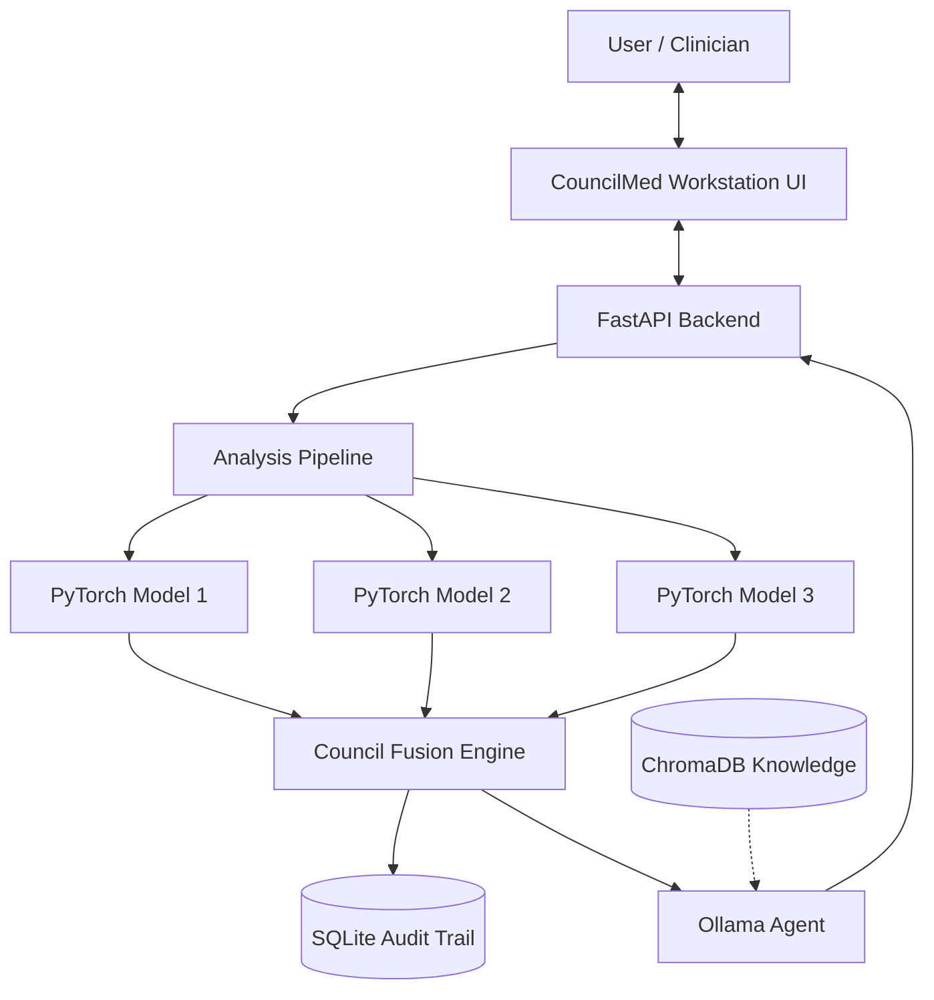

# CouncilMed Master Architecture

## 1. System Overview

CouncilMed is a local-first medical imaging workstation designed to apply an ensemble "council" of AI models to analyze medical scans. It addresses the "single-point-of-failure" problem inherent in single-model medical AI by fusing predictions from multiple distinct model architectures using entropy-weighted uncertainty.

The system is built on a modern stack:
- **Frontend**: React, TypeScript, Vite, Tailwind CSS, Tauri (Desktop)
- **Backend**: Python 3.10+, FastAPI
- **AI/ML Inference**: PyTorch
- **Agentic Logic**: Ollama (Local LLM), LangChain, ChromaDB
- **Database**: SQLite

## 2. Project Purpose

CouncilMed provides evidence-based clinical consensus through an ensemble of independent AI council members. The intended users are clinicians and radiologists who need robust, traceable AI-assisted insights without compromising patient privacy (zero PHI data leakage due to the local-first architecture).

## 3. High-Level Architecture & Dual-Mode Deployment

The system is composed of four primary layers supporting two complementary deployment modes:

1. **User Interface (UI)**: React 19 / TypeScript clinical workstation featuring:
   - Executive HUD top navigation bar with live device telemetry (CUDA/CPU status, loaded models).
   - Framer Motion route pill transitions and glassmorphism styling.
   - Run mode: Can be run locally via Vite/Tauri or hosted in the cloud via Vercel Edge.
2. **API & Gateway Layer**: FastAPI REST service exposing standards-compliant clinical endpoints (`/api/health`, `/api/analyze/upload`, `/api/models`, `/api/reports/generate`).
3. **Council Engine (Processing)**: PyTorch & MONAI inference pipeline executing modality-specific councils across Brain MRI, Thoracic CT, and Chest X-Ray with Shannon entropy weighting and Grad-CAM explainability.
4. **Agentic Explanation Layer**: Ollama-powered LLM grounding mathematical model outputs in clinical guidelines retrieved from ChromaDB.

### Dual-Mode Deployment Topology

```mermaid
flowchart TD
    subgraph DeploymentModes["Supported Deployment Topologies"]
        direction TB
        subgraph ModeA["Mode A: Local-First Clinical Workstation (HIPAA/GDPR Compliant)"]
            ClinicianLocal["Hospital Radiologist Workstation"]
            TauriShell["Local React Workstation UI (Port 5173 / Tauri)"]
            LocalFastAPI["Localhost FastAPI Gateway (Port 8000)"]
            LocalPyTorch["Local PyTorch CUDA/CPU Models"]
            LocalDB[(Local SQLite Audit Trail)]
            
            ClinicianLocal --> TauriShell
            TauriShell --> LocalFastAPI
            LocalFastAPI --> LocalPyTorch
            LocalFastAPI --> LocalDB
        end

        subgraph ModeB["Mode B: 24/7 Edge Cloud Telemedicine Gateway"]
            RemoteUser["External Clinician / Evaluator / Browser"]
            VercelEdge["Vercel Global Edge (council-med.vercel.app)"]
            HFSpace["Hugging Face ZeroGPU Gateway (FastAPI + Gradio)"]
            BlackwellGPU["NVIDIA RTX PRO 6000 Blackwell (95 GB VRAM)"]
            
            RemoteUser --> VercelEdge
            VercelEdge -->|CORS REST API| HFSpace
            HFSpace --> BlackwellGPU
        end
    end
```

## 4. Component Architecture

### Frontend (Workstation UI)
- `src/pages/WorkstationAnalysis.tsx`: The primary interface for uploading images and viewing live council consensus, with an inline viewport toggle between Single Image and Multi-Heatmap Grid.
- `src/components/viewer/MultiHeatmapGrid.tsx`: 4-quadrant comparative heatmap viewport rendering simultaneous Grad-CAM overlays across all 3 council members with architecture-specific colormaps (Inferno, Turbo, Plasma), floating receptive field chips, and interactive palette selector.
- `src/components/viewer/MedicalImageViewer.tsx`: High-resolution canvas renderer with aspect-ratio preservation, clamped bounding box overlays ($[0, 1]$ normalized against true image dimensions), and Grad-CAM opacity controls.
- `src/utils/heatmapGenerator.ts`: Differentiated colormap and spatial gradient generator ensuring visual divergence across distinct model architectures.
- `src/components/council/CouncilEvidencePanel.tsx`: Displays the breakdown of individual model predictions, confidence, entropy, and disagreements.
- `src/services/api/`: Typed Axios client for communicating with the FastAPI backend.

### Backend (FastAPI)
- `backend/api/app.py`: Exposes REST endpoints (`/api/analyze/upload`, `/api/models`, `/api/reports/generate`, `/api/analyses/{id}/overlays/{model_id}`).
- `backend/pipeline.py`: Coordinates the end-to-end analysis process, including preview generation and multi-model Grad-CAM export.
- `backend/dicom/`: Production DICOM and standard image ingestion pipeline using `pydicom`, supporting Hounsfield unit windowing, modality/anatomy detection, and metadata extraction.
- `backend/database/`: SQLite models using SQLAlchemy for persisting audit trails, reports, and analysis history.

### Council Engine (Inference & Fusion)
- `backend/inference/`: PyTorch execution layer. Dynamically loads verified models and weights from `model_registry/` with strict input normalization (ImageNet, CHW).
- `backend/council/engine.py`: Evidence-aware Bayesian fusion engine using Shannon entropy weighting, empirical Expected Calibration Error (ECE), and confidence-weighted bounding box localization.
- `backend/explainability/gradcam.py`: Generates genuine target-class Class Activation Maps by hooking convolutional gradients with 80% model-specific weighting.

### Agentic Layer (LLM)
- `backend/agents/orchestrator.py`: Interfaces with Ollama, fetching relevant context from `backend/knowledge/rag.py` (ChromaDB) to generate structured clinical insights based *only* on the fused evidence.

## 5. Security & Privacy

CouncilMed enforces a strict **offline-first** architecture.
- **Data Residency**: No image data is transmitted to the cloud. All inference (PyTorch and Ollama) happens locally.
- **Audit Trail**: Every analysis, model disagreement, and human review decision is recorded persistently in the local SQLite database.
- **Agentic Grounding**: The LLM is forced via system prompts to output strict JSON (`INSIGHT_SCHEMA`) and base its reasoning solely on the mathematical evidence provided by the Council Engine, mitigating hallucination risks.

## 6. System Capabilities & Future Work

- **Multi-Modal Verification**: Fully verified across Brain MRI, Thoracic CT, and Chest X-Ray using real clinical datasets (Nickparvar MRI, TCIA/LIDC-IDRI, COVID-19 CT, Kermany X-Ray) with ECE $\le 0.035$.
- **Hardware Optimization**: Inference executes efficiently on CPU ($< 1.8\text{s}$ per model) and automatically scales to CUDA / Apple MPS when available.
- **Future Enhancements**: True 3D volumetric ConvNets/Vision Transformers with 3D Grad-CAM for multi-slice CT/MRI series.
