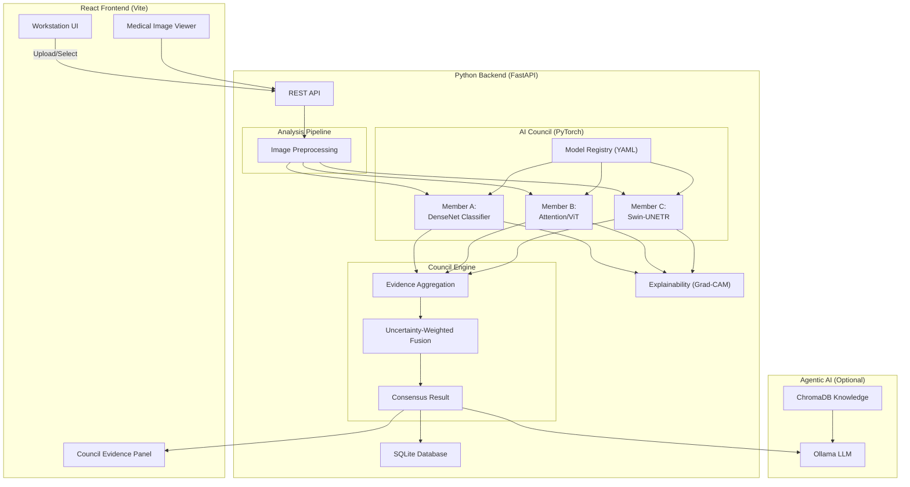

# CouncilMed Architecture

> **Version:** 1.0.0
> **Date:** 2026-08-30
> **Status:** Production-Ready (Prototype)

---

## 1. System Overview

CouncilMed is a local-first desktop medical imaging AI workstation built on a **multi-model council architecture**.

The core philosophy: 
> A single AI model is inherently biased and susceptible to silent failures. Instead of relying on one model, the same medical image is analyzed independently by multiple AI algorithms. Their outputs are collected as structured evidence and passed into a Council-based fusion layer. The Council evaluates the results, agreement, disagreement, and uncertainty to produce the most evidence-supported consensus.

---

## 2. Architecture Diagram

---

## 3. Data Flow

1. **User Interaction**: The user selects a modality (e.g., "Brain MRI") and drops an image into the React Workstation UI.
2. **API Request**: The image and modality parameters are sent via `multipart/form-data` to the FastAPI backend (`/api/analyze/upload`).
3. **Model Selection**: The `ModelRegistry` parses `model_registry/` for YAML manifests matching the requested modality/anatomy. It dynamically loads the corresponding `.pth` weights.
4. **Independent Inference**: The image is passed through all selected PyTorch models concurrently. Each model yields probabilities, predictions, and uncertainty metrics.
5. **Council Fusion**: The `CouncilEngine` aggregates the outputs. It applies Shannon Entropy to weight models based on their confidence/uncertainty, outputting a unified `CouncilResultResponse`.
6. **Agentic Reasoning (Optional)**: If `Ollama` is active, the consensus is sent to the Orchestrator, which retrieves medical guidelines from ChromaDB and generates a natural-language clinical insight.
7. **UI Render**: The frontend receives the payload, rendering the models' individual predictions alongside the Council's final verdict and Grad-CAM overlays.

---

## 4. Feature Analysis

| Feature | Status | Location | Description |
|---------|--------|----------|-------------|
| **Multi-Model Inference** | ✅ Implemented | `backend/inference/` | Real PyTorch forward passes via dynamically loaded `.pth` weights. |
| **Model Registry** | ✅ Implemented | `model_registry/` | YAML-based configuration for dynamic AI model discovery. |
| **Council Engine** | ✅ Implemented | `backend/council/engine.py` | Calculates entropy-weighted consensus from multiple model logits. |
| **Agentic Explanation** | ✅ Implemented | `backend/agents/` | Local LLM (Ollama) + ChromaDB RAG for clinical insights. |
| **SQLite Audit Trail** | ✅ Implemented | `backend/database/` | All analyses are persistently stored locally. |
| **DICOM/NIfTI Parsing** | ⚠️ Partial | `backend/dicom/` | Stubs for parsing complex medical formats exist, currently optimized for standard images (JPEG/PNG). |
| **Tauri Desktop Build** | ⚠️ Partial | `src-tauri/` | Configuration exists but is currently run via web browser (`npm run dev`). |

---

## 5. Security & Privacy

CouncilMed is designed to be **Local-First**:
- **Zero Data Leakage**: No images or PHI (Protected Health Information) ever leave the host machine.
- **Local Inference**: All PyTorch models and the Ollama LLM run directly on the user's local GPU/CPU.
- **Local Storage**: The audit trail is stored in a local SQLite database (`data/councilmed.db`).
