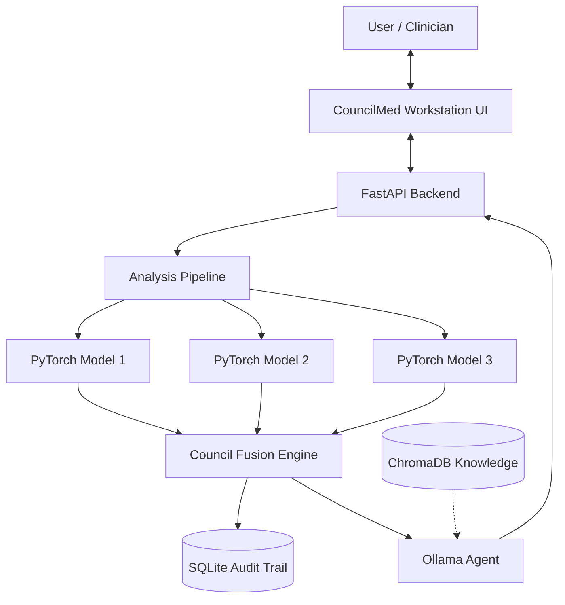

# CouncilMed Master Architecture

## 1. System Overview

CouncilMed is a local-first medical imaging workstation designed to apply an ensemble "council" of AI models to analyze medical scans. It addresses the "single-point-of-failure" problem inherent in single-model medical AI by fusing predictions from multiple distinct model architectures using entropy-weighted uncertainty.

The system is built on a modern stack:
- **Frontend**: React, TypeScript, Vite, Tailwind CSS, Tauri (Desktop)
- **Backend**: Python 3.10+, FastAPI
- **AI/ML Inference**: PyTorch
- **Agentic Logic**: Ollama (Local LLM), LangChain, ChromaDB
- **Database**: SQLite

## 2. Project Purpose

CouncilMed provides evidence-based clinical consensus through an ensemble of independent AI council members. The intended users are clinicians and radiologists who need robust, traceable AI-assisted insights without compromising patient privacy (zero PHI data leakage due to the local-first architecture).

## 3. High-Level Architecture

The system is composed of four primary layers:
1. **User Interface (UI)**: A React-based workstation running as a Tauri desktop application.
2. **API/Application Layer**: A FastAPI backend that orchestrates the workflow.
3. **Council Engine (Processing)**: A PyTorch-based inference pipeline that loads registered models, executes them, and fuses their results using Shannon entropy.
4. **Agentic Explanation Layer**: An Ollama-powered LLM that grounds the mathematical model outputs in actual clinical guidelines retrieved from a ChromaDB vector database.

## 4. Component Architecture

### Frontend (Workstation UI)
- `src/pages/WorkstationAnalysis.tsx`: The primary interface for uploading images and viewing live council consensus.
- `src/components/council/CouncilEvidencePanel.tsx`: Displays the breakdown of individual model predictions, confidence, and disagreements.
- `src/services/api/`: Typed Axios client for communicating with the FastAPI backend.

### Backend (FastAPI)
- `backend/api/app.py`: Exposes REST endpoints (`/api/analyze`, `/api/models`, `/api/reports/generate`).
- `backend/pipeline.py`: Coordinates the end-to-end analysis process.
- `backend/database/`: SQLite models using SQLAlchemy for persisting audit trails and analysis history.

### Council Engine (Inference & Fusion)
- `backend/inference/`: PyTorch execution layer. Loads models dynamically from the `model_registry/`.
- `backend/council/engine.py`: Contains the `fuse_predictions` logic using entropy and calibration weighting.
- `backend/explainability/gradcam.py`: Generates visual heatmaps for model explainability.

### Agentic Layer (LLM)
- `backend/agents/orchestrator.py`: Interfaces with Ollama, fetching relevant context from `backend/knowledge/rag.py` (ChromaDB) to generate structured clinical insights based *only* on the fused evidence.

## 5. Security & Privacy

CouncilMed enforces a strict **offline-first** architecture.
- **Data Residency**: No image data is transmitted to the cloud. All inference (PyTorch and Ollama) happens locally.
- **Audit Trail**: Every analysis, model disagreement, and human review decision is recorded persistently in the local SQLite database.
- **Agentic Grounding**: The LLM is forced via system prompts to output strict JSON (`INSIGHT_SCHEMA`) and base its reasoning solely on the mathematical evidence provided by the Council Engine, mitigating hallucination risks.

## 6. Limitations

- **Hardware Requirements**: Running multiple PyTorch models and a local LLM concurrently requires significant local compute (preferably a CUDA-capable GPU).
- **Model Quality**: The current repository uses structural PyTorch models with random initialization (`weights=None`) generated by `scripts/generate_weights.py`. These must be replaced with genuinely trained models for clinical accuracy.
- **DICOM Support**: The integration pipeline for `pydicom` is currently incomplete, limiting full clinical PACS integration.
