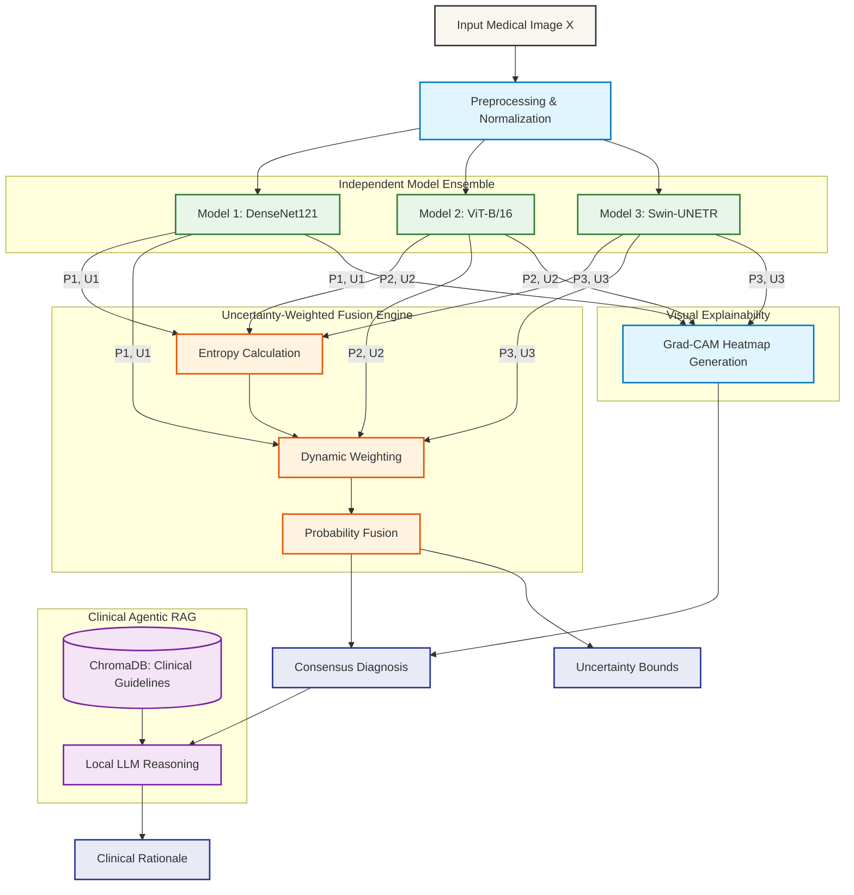

# CouncilMed: Research Paper Reference Document

This document provides formal architectural diagrams, algorithm definitions, and mathematical equations used in the CouncilMed system. It is designed to be directly referenced or adapted for academic publications and research papers.

---

## 1. System Architecture Diagram

The following diagram illustrates the complete end-to-end data flow of the CouncilMed multi-model fusion and agentic RAG architecture.

---

## 2. Mathematical Formalization of Algorithms

### 2.1. Predictive Entropy and Sharpness
To quantify the predictive confidence of each individual model $m \in M$, we calculate the normalized Shannon entropy of its output probability distribution $P_m$ over the set of possible classes $C$.

$$ H(P_m) = - \sum_{c \in C} P_m(c) \log_2(P_m(c)) $$

To convert this entropy into a positive weighting factor (sharpness), we normalize it against the maximum possible entropy (which occurs when all classes are equally probable, $\log_2 |C|$):

$$ S_m = 1 - \frac{H(P_m)}{\log_2 |C|} $$

Where $S_m \in [0, 1]$. A higher $S_m$ indicates a more confident, sharper prediction.

### 2.2. Dynamic Uncertainty-Weighted Fusion
Unlike simple ensemble averaging, CouncilMed dynamically assigns weights $W_m$ to each model per inference instance. The weight is a linear combination of four normalized factors:
1. **Sharpness ($S_m$)**: Instance-level confidence.
2. **Reported Uncertainty ($U_m$)**: Epistemic/aleatoric uncertainty estimated by the model (e.g., via Monte Carlo Dropout).
3. **Calibration Error ($ECE_m$)**: Expected Calibration Error historically validated.
4. **Historical AUROC ($AUROC_m$)**: Discriminative performance scaled to $[0, 1]$.

$$ W_m = \alpha S_m + \beta (1 - U_m) + \gamma (1 - ECE_m) + \delta (2 \cdot AUROC_m - 1) $$

Where $\alpha, \beta, \gamma, \delta$ are hyperparameters controlling the influence of each metric (default: $\alpha=0.3, \beta=0.3, \gamma=0.2, \delta=0.2$).

The final consensus probability distribution $P_{consensus}$ is the weighted sum of the individual model probabilities:

$$ P_{consensus}(c) = \sum_{m \in M} \left( \frac{W_m}{\sum_{j \in M} W_j} \right) P_m(c) $$

### 2.3. Consensus Agreement Level
To quantify the agreement among the ensemble members, we calculate the standard deviation of the predicted probabilities for the consensus target class $c^*$:

$$ \sigma = \sqrt{ \frac{1}{|M|} \sum_{m \in M} \left( P_m(c^*) - \bar{P}(c^*) \right)^2 } $$

The agreement level is inversely proportional to this variance.

---

## 3. Explainability Equations (Grad-CAM)

To provide visual localization of the clinical findings, CouncilMed utilizes Gradient-weighted Class Activation Mapping (Grad-CAM). 

For a given model, the gradient of the score for class $c$ (before softmax), denoted $y^c$, with respect to feature map activations $A^k$ of a convolutional layer is computed. The neuron importance weights $\alpha_k^c$ are obtained via global average pooling:

$$ \alpha_k^c = \frac{1}{Z} \sum_i \sum_j \frac{\partial y^c}{\partial A_{i,j}^k} $$

Where $Z$ is the number of pixels in the feature map. The final spatial heatmap $L_{Grad-CAM}^c$ is a weighted combination of forward activation maps, followed by a ReLU to isolate positive influences:

$$ L_{Grad-CAM}^c = ReLU \left( \sum_k \alpha_k^c A^k \right) $$

---

## 4. Agentic Retrieval-Augmented Generation (RAG)

The Council's mathematical consensus is interpreted into a clinical rationale using an LLM. To reduce hallucinations, the LLM retrieves context from a vector database populated with clinical guidelines (e.g., ACR appropriateness criteria).

The similarity between the consensus query vector $Q$ and document vectors $V_d$ is calculated using Cosine Similarity:

$$ sim(Q, V_d) = \frac{Q \cdot V_d}{||Q|| ||V_d||} $$

The top $K$ documents maximizing this similarity are injected into the prompt context for the LLM.
