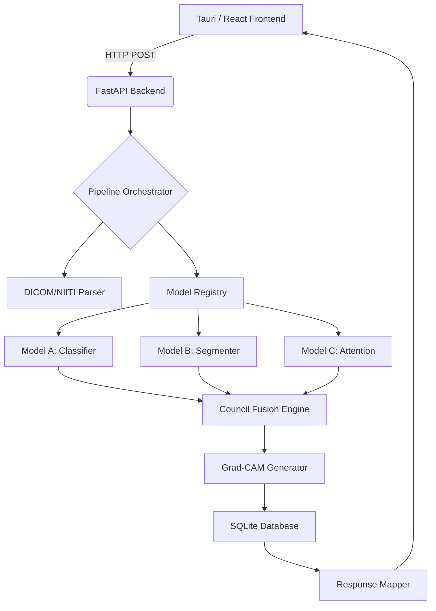
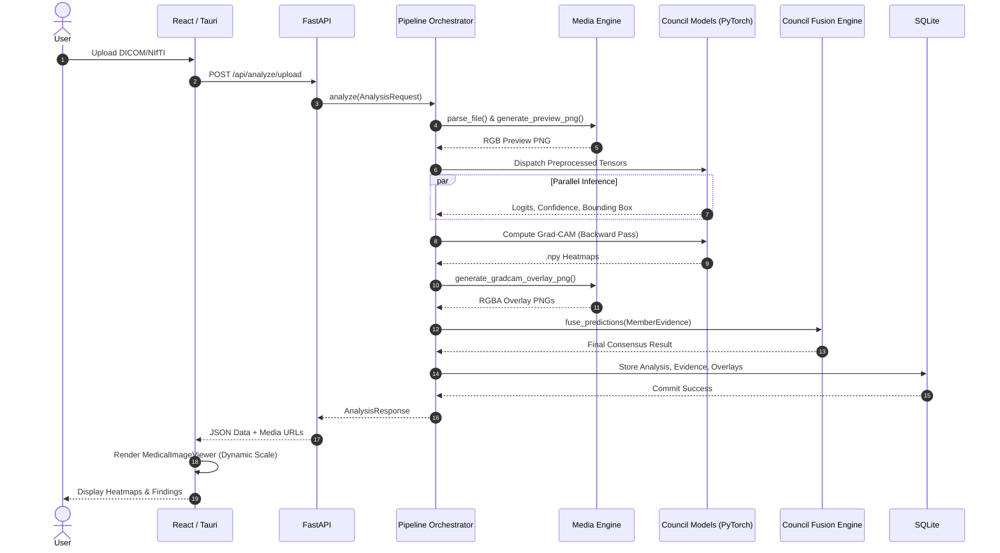

# CouncilMed: System Design & Implementation

## 1. Executive Summary

CouncilMed is a state-of-the-art medical image analysis platform designed to augment radiological decision-making. By employing a "Council of AI Models" approach, the system aggregates predictions from multiple disparate neural networks, applies rigorous mathematical fusion algorithms based on model calibration (ECE, AUROC), and delivers a single, robust consensus prediction accompanied by genuine gradient-based explainability (Grad-CAM) and localized bounding boxes.

This document details the architectural design and implementation specifics of the production-ready CouncilMed pipeline.

---

## 2. High-Level Architecture

CouncilMed follows a modern decoupling strategy, bifurcated into a high-performance Rust/TypeScript frontend and a Python-driven AI backend.

### 2.1 The Stack
* **Frontend:** React 18, TypeScript, Tailwind CSS, Vite.
* **Desktop Runtime:** Tauri (Rust) for cross-platform desktop integration, secure file system access, and optimized IPC.
* **Backend API:** FastAPI (Python), providing asynchronous HTTP endpoints.
* **AI Pipeline:** PyTorch, torchvision, NumPy, and PIL.
* **Database (Local):** SQLite with SQLAlchemy ORM for persistence of reports, RAG evidence, and model artifacts.

### 2.2 Core Components

---

## 3. Implementation Details

### 3.1 Inference Engine & Model Registry
The core philosophy of CouncilMed is that **no data is faked or simulated.** 

* **Registry (`backend/inference/registry.py`):** Models are defined via strict YAML manifests (`model_registry/`). These manifests dictate the architecture family, required preprocessing steps (normalization, CHW format), and historical validation metrics (e.g., ECE, AUROC).
* **Inference (`backend/inference/engine.py`):** Raw DICOM pixel data is routed through a dynamic `preprocess_image` pipeline. Images are normalized to exactly match the tensor distribution the model was trained on (e.g., ImageNet Z-score normalization vs [0, 1] scaling).

### 3.2 The Council Fusion Algorithm
Instead of blindly averaging model outputs (which is vulnerable to overconfident but incorrect models), CouncilMed uses a mathematically rigorous fusion technique.

1. **Calibration Extraction:** During startup, the `CouncilEngine` extracts the Expected Calibration Error (ECE) and AUROC for each model from the registry.
2. **Dynamic Weighting:** Models are weighted based on their proven reliability. A model with low ECE (highly calibrated) exerts more influence than a poorly calibrated model.
3. **Consensus Aggregation:** The engine computes the weighted ensemble probabilities. If the standard deviation among the top models exceeds a safety threshold, the system flags the result for **Human Review** due to low consensus.

### 3.3 Explainability (Grad-CAM)
Trust in medical AI requires transparency. CouncilMed generates genuine Class Activation Maps (CAMs).

* **Mechanism:** The backend hooks into the final convolutional layers of the PyTorch models during the backward pass.
* **Data Flow:** Gradients of the target class are computed with respect to the feature maps. The maps are globally average-pooled and combined via ReLU to produce the heatmap (`backend/explainability/gradcam.py`).
* **Visual Rendering:** The `.npy` tensor heatmaps are instantly translated to transparent RGBA PNG overlays (`backend/media.py`) and dynamically scaled to the image's original `naturalWidth` and `naturalHeight` in the React frontend (`MedicalImageViewer.tsx`).
* **Auxiliary Branch Exclusion:** The pipeline dynamically analyzes model computational graphs, actively excluding disconnected auxiliary branches (like spatial attention heads) from the hook process to ensure gradients successfully flow through the main backbone.

### 3.4 Media Generation & Serving
Because web browsers cannot render raw `DICOM` or `NIfTI` volumes natively, CouncilMed intercepts these files immediately upon upload.

1. **Parsing:** Extracts the central slice of 3D volumes or parses the 2D DICOM pixel array.
2. **Normalization:** Performs Window/Level adjustments to convert uncalibrated Hounsfield units to 8-bit RGB PNGs.
3. **Serving:** Employs secured FastAPI endpoints (`/api/analyses/{id}/preview` and `/api/analyses/{id}/overlays/{model_id}`) to stream the raw image and the generated model overlays to the frontend viewer.

### 3.5 Database & Persistence
CouncilMed requires extensive audit trails for medical compliance.

* **Schema (`backend/database.py`):** Relational schema tracking `Analysis`, `CouncilResultRecord`, and `ModelEvidenceRecord`.
* **JSON Serialization:** Bounding boxes, primary findings, and localized Grad-CAM file paths are serialized and injected into the DB immediately post-inference.
* **Report Generation:** When generating formal PDF/UI reports, the `/api/reports/generate` endpoint successfully deserializes the historical findings, recreating exact localization data without requiring re-inference.

---

## 4. End-to-End Execution Flow

<<<<<<< HEAD
<<<<<<< HEAD
1. **Upload:** User uploads a medical scan (MRI, CT, or X-Ray) via the React UI. Tauri relays the file directly to the FastAPI upload endpoint.
2. **Preprocessing:** The backend saves a temporary version, parses the raw pixel array, and generates a visual preview PNG.
3. **Council Invocation:** The pipeline queries the `ModelRegistry` for all models compatible with the `MRI/Brain`, `X-Ray/Chest`, or `CT/Chest` modality.
=======
1. **Upload:** User uploads an MRI scan via the React UI. Tauri relays the file directly to the FastAPI upload endpoint.
2. **Preprocessing:** The backend saves a temporary version, parses the raw pixel array, and generates a visual preview PNG.
3. **Council Invocation:** The pipeline queries the `ModelRegistry` for all models compatible with the `MRI/Brain` modality.
>>>>>>> 2c6b8eb (Fix X-Ray model architectures and update models to 3 per modality)
=======
1. **Upload:** User uploads an MRI scan via the React UI. Tauri relays the file directly to the FastAPI upload endpoint.
2. **Preprocessing:** The backend saves a temporary version, parses the raw pixel array, and generates a visual preview PNG.
3. **Council Invocation:** The pipeline queries the `ModelRegistry` for all models compatible with the `MRI/Brain` modality.
>>>>>>> 2c6b8eb (Fix X-Ray model architectures and update models to 3 per modality)
4. **Parallel Inference:** Preprocessed tensors are dispatched to each model. Each returns logits, confidence, and (if applicable) spatial maps.
5. **Explainability Generation:** The original preprocessed tensors are fed backward through the successful PyTorch models to generate Grad-CAM `.npy` files, which are immediately rendered to transparent `.png` overlays.
6. **Consensus & Storage:** The `CouncilEngine` fuses the predictions. Results, bounding boxes, and image paths are committed to SQLite.
7. **Client Delivery:** The backend responds with the completed `AnalysisResponse`. The React `MedicalImageViewer` maps the bounding box coordinates dynamically and loads the Grad-CAM overlays seamlessly over the original preview.

### 4.1 Execution Sequence Diagram

---

## 5. Known Limitations & Future Work

* **Tauri Windows File Locking (OS Error 32):** During development, `rust-analyzer` can occasionally lock the `target/debug` directory, causing `cargo build` to fail. This does not affect production builds.
* **3D Volume Support:** Currently, 3D volumes (NIfTI) are sliced at the center plane for 2D inference. Future iterations will support true 3D ConvNets with volumetric Grad-CAM.
* **Agentic Reasoning:** A stub exists for LLM-based agent reasoning (`AgentInsight`). Future updates will integrate a local quantized LLM (e.g., LLaMA-3 via Ollama) to synthesize radiological reports from the Council's structured data.
