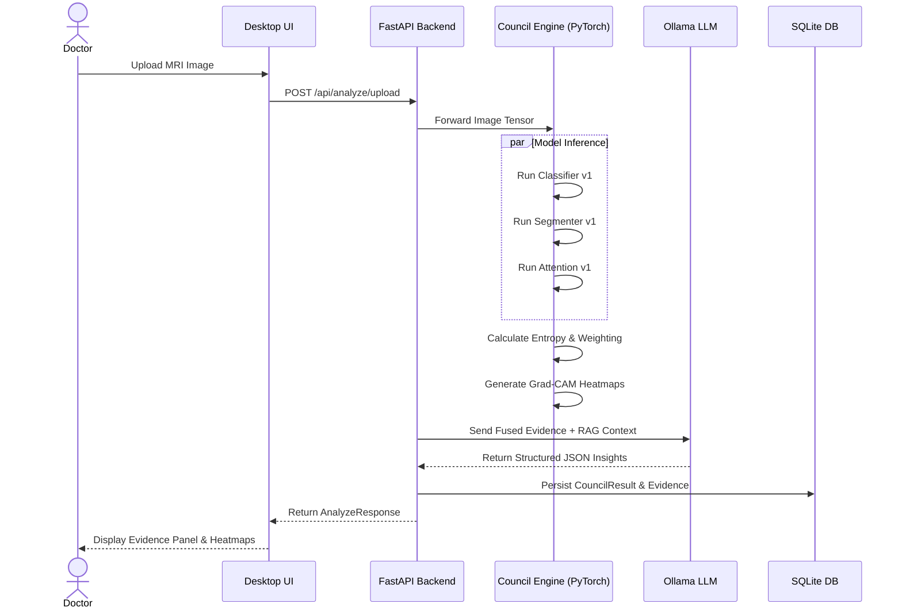
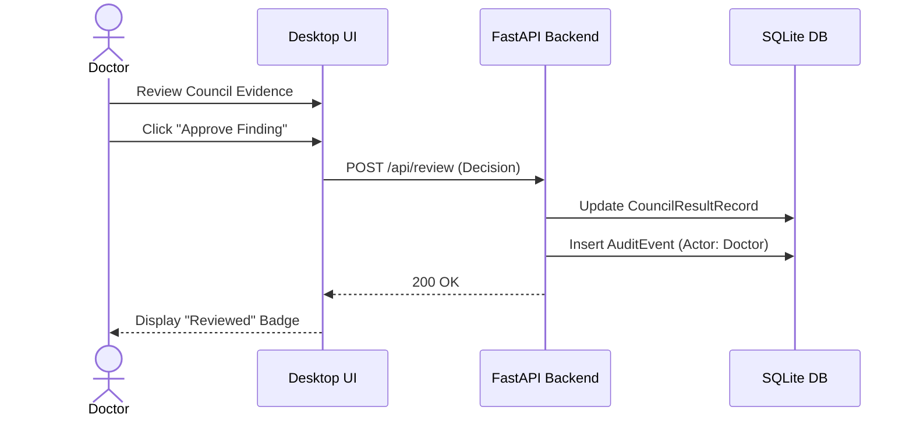

# CouncilMed User Workflow

This document illustrates the typical user journey and system interaction sequences within CouncilMed.

## Core Clinical Workflow

### 1. Launch & Setup
1. **Launch**: The clinician opens the CouncilMed Tauri desktop application.
2. **Initialization**: The Tauri backend (`lib.rs`) spawns the Python FastAPI server as a sidecar process.
3. **Health Check**: The React UI polls `/api/health` until the PyTorch models are successfully loaded into memory.

### 2. Analysis Initiation
1. **Provide Input**: The user drags and drops a medical scan (e.g., a Brain MRI) into the Workstation dropzone.
2. **Specify Modality**: The user selects the modality (MRI) and anatomy (Brain) from the UI dropdowns.
3. **Submit**: The UI triggers the `analyze_uploaded_image` API endpoint.

### 3. Live Processing
1. **Processing Indicator**: The UI displays a "Processing..." state.
2. **Inference**: The backend runs the image through the ensemble of models (Classifier, Segmenter, Attention).
3. **Fusion**: The Council Engine evaluates the results, calculates entropy, and flags any disagreements.

### 4. Evidence Review
1. **Results Display**: The UI renders the `CouncilEvidencePanel`.
2. **Consensus Review**: The clinician reviews the fused "Primary Finding" and the ensemble "Uncertainty" score.
3. **Model Drill-down**: The clinician clicks on individual models to see their specific predictions, confidence levels, and Grad-CAM explainability heatmaps overlaying the original image.

### 5. AI Agent Interaction
1. **Agent Insights**: The UI displays the Ollama-generated `AgentInsightResponse`, including safety flags and clinical significance.
2. **Contextualization**: The clinician reads how the mathematical finding correlates with established medical literature (RAG).

### 6. Human Review & Reporting
1. **Decision**: The clinician accepts, modifies, or rejects the AI consensus.
2. **Audit Logging**: The human decision is submitted to `/api/review` and permanently logged in the SQLite database.
3. **Report Generation**: The user navigates to the "Reports" tab and clicks "Generate Report".
4. **Final Output**: The system formats the verified evidence into a structured clinical report (.txt), which the user can copy into their hospital's main EMR/EHR system.

---

## Sequence Diagrams

### Full Analysis Sequence

### Human Review Sequence

